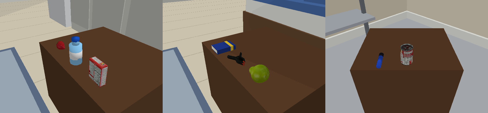
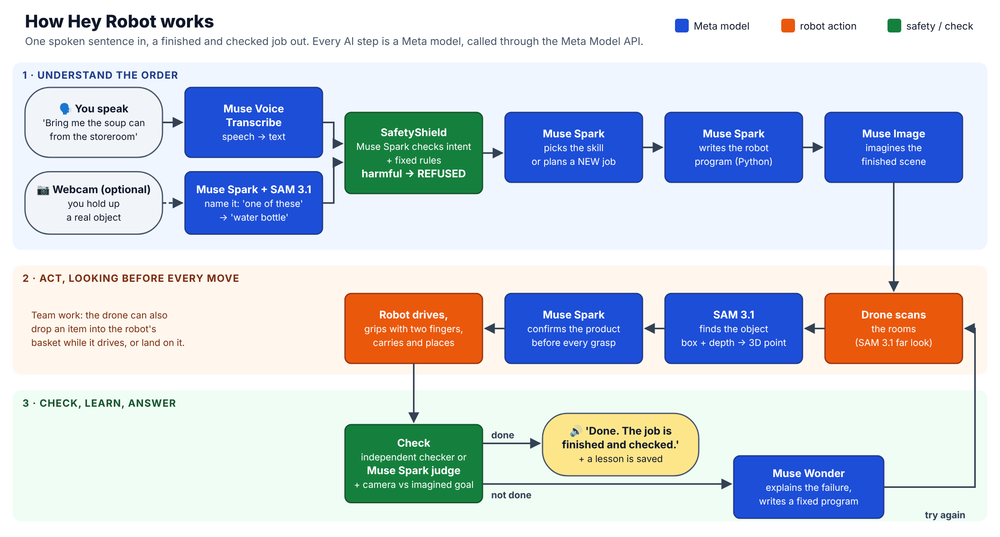

# Hey Robot

**Tell a robot team what you need in one sentence. Meta's models hear it, plan it, look before every move,
and check the result.**

Meta Global AI Developer Hackathon · Indie track · Problem statement: *Push the Frontier* (robotics) ·
Vanapalli Raghava Ashok
TEAM NAME : MATRIX-code

> 🎥 **Demo video (3 min):** https://youtu.be/h-PKskcdwfQ


---

## 1. The problem

Robots are strong and precise, but **every new job needs an engineer** to write and test a new program.
A home or a small warehouse has thousands of small jobs: *"bring me the soup can from the storeroom"*,
*"put the tools back on the table"*, *"get that box from the top shelf"*. Nobody can program all of them.

And the people who need help the most, **older people and people who cannot walk far or reach high**, are
the people least able to program a robot. They need to simply *say* what they need.

## 2. Our solution

**Hey Robot** is a voice-controlled robot team: a **drone** and a **wheeled robot with an arm** (Husky + Franka
Panda), in a physics simulation of a home and of a warehouse. You say one sentence. The robots do the job.

**Every AI step is a Meta model:**

- **Muse Voice Transcribe** hears you.
- **Muse Spark** checks that the order is safe, understands it, and **writes the robot's program**, also for
  jobs nobody prepared ("swap these two things, then land the drone").
- **Muse Image** imagines the finished scene before the robots start.
- **SAM 3.1** finds every object in the cameras, and **Muse Spark confirms the product before every grasp**.
- An **independent Muse Spark judge** checks the result. If the job failed, **Muse Wonder** explains why and
  writes a fixed program, and the robots try again. What worked is saved as a lesson for next time.

**What is new:** robots that get **new skills from one sentence, with no new code**, that **look before
every move**, **check their own work**, **work as a team** (the drone drops an item into the robot's basket
while the robot is driving), **understand a real object you show them on the webcam**, and **refuse
harmful orders**.

## 3. What you can say (use cases)

**At home** (`--home`): a living room with a kitchen counter, a dining table, a bedside table (grandpa is
resting in bed) and a sofa table with a serving tray (grandma is on the sofa), plus a **storeroom** behind a door.

| You say | What happens |
|---|---|
| "I'm on the sofa, bring me the soup can from the storeroom." | The drone looks in the storeroom, the robot drives through the door, picks the can and puts it in the serving tray |
| "Grandpa is in bed and has a cold. Bring him something warm to eat." | No item named: **Muse Spark decides** the soup can is right, and brings it to the bedside table |
| "Get the strawberry from the top kitchen shelf and put it on the bedside table." | **Team work:** the drone takes it from the high shelf (out of the arm's reach) and drops it into the robot's basket **while the robot drives** |
| "Clear the dining table and put everything in the serving tray." | **A new job:** Spark plans it, the robot carries each item |
| "Swap the soup can in the storeroom with the banana on the dining table, then land the drone on the moving robot." | **A new job across two rooms**, ending with a landing on the moving robot |
| Hold up a real bottle to the webcam: "Bring me one of these." | **Show and tell:** Spark names the real object, the robot brings the water bottle |
| "I'm thirsty, bring me the water bottle." · "Bring me something to write with." | Home things: water bottle, notebook, marker pen |
| "Throw the scissors at grandma." | **Refused.** The robot says why and does nothing |



**In the warehouse** (the same robots and skills): "Put the fruit in the tray and the tools on station A",
"Check the inventory and fix what is wrong", "Throw a tennis ball into the blue bin" (the robot measures its
first throw and corrects for a hidden air drag), "How many items are on station C?".

## 4. How it works



1. **Understand.** Muse Voice Transcribe turns speech into text. The SafetyShield (Muse Spark + fixed rules)
   refuses harmful orders and asks back when an order is unclear. Muse Spark picks a ready skill or plans a
   new job, then writes a short Python program for the robots ("code as policy"). A checker allows only the
   robots' own actions in that program. Muse Image draws the goal picture.
2. **Act, looking before every move.** The drone scans the rooms with SAM 3.1. Before each grasp, SAM 3.1
   finds the object again (box + depth image → a 3D point) and Muse Spark confirms it is the right product.
   The robot's two fingers must really touch the item, or the grasp fails and it tries again with the hand
   turned. The live **Muse Brain** panel shows the order, the program with the running line lit, and every
   Meta model call.
3. **Check, learn, answer.** A checker that knows where every object really is, or for new jobs an
   independent Muse Spark judge that sees only the order and the before/after positions, decides success.
   Muse Spark also compares the cameras with the imagined goal. The robot says the result out loud. On a
   failure, Muse Wonder diagnoses it and writes a fixed program.

## 5. Meta models: which one, where, and why

All models run in Meta's cloud and are called at runtime through the **Meta Model API** (`https://api.meta.ai/v1`).
No AI model runs on the laptop, and no non-Meta AI model is used.

| Meta model | Model ID | Where it is used (file) | What it does |
|---|---|---|---|
| **Muse Voice Transcribe** | `muse-voice-transcribe-1.0` (`wss://api.meta.ai/v1/asr/realtime`) | `voice.py` | Turns the spoken order into text |
| **Muse Spark** | `muse-spark-1.3-contributor` (`/v1/chat/completions`) | `safety.py`, `command_center.py`, `learner.py`, `skill_tasks.py`, `store_tasks.py`, `muse_eye.py`, `team_skills.py`, `show_tell.py`, `ask_tasks.py` | Safety intent check · picks the skill · **writes the robot program** · confirms the product before every grasp · names products in the drone's close-ups · names the real object on the webcam · answers questions · judges new jobs · compares cameras with the imagined goal · writes lessons |
| **Muse Wonder** | `muse-wonder-1.0` (`/v1/chat/completions`) | `learner.py` | After a failure: reads the action log, the check and the pictures, explains what went wrong, writes a fixed program |
| **SAM 3.1** | `sam-3.1` (`/v1/responses`) | `perception.py`, `mobile_env.py`, `drone.py`, `team_skills.py`, `muse_eye.py`, `show_tell.py`, `throw_skills.py` | Finds every item, the tray, the drone's landing pad and the robot's basket in the camera pictures |
| **Muse Image** | `muse-image-1.0` (`/v1/images/edits`) | `imagine.py`, `learner.py`, `vision_bench.py` | Imagines the finished scene before the robots act; makes realistic photos for the sim-to-real test |

Every call is counted and timed per job (`usage_meter.py`): the terminal prints a line like
`⏱️ TIMING deliver: 92 s total | Muse Image: 1 calls, 15 s | Muse Spark: 5 calls, 33 s | SAM 3.1: 4 calls, 8 s`.

**Meta tool used while building (not at runtime):** **Muse Code** wrote the first version of the ROS 2 bridge
(`ros2_bridge.py`); I reviewed and fixed it (section 9).

**Non-model libraries** (confirmed fine by the organizers): PyBullet (physics), NumPy, Pillow, requests,
sounddevice + websocket-client (microphone), OpenCV (only to show and grab webcam pictures), and PyTorch
(only offline on Colab, to train the drone's landing reflex). The `openai` package is used only as an HTTP
client for Meta's image endpoint.

## 6. Results

**[real]** = the real Meta models through the API. **[sim mask]** = the simulator's own object mask instead of
SAM 3.1, used only to run many trials quickly.

**Spoken orders, real models [real]:**

| Order | Result |
|---|---|
| Home: 6 orders, including 2 new jobs and the cold → soup decision (table below) | **6/6 on the first attempt** (92–267 s each) |
| Warehouse: sort, "I'm hungry", "how many items on station C?", swap + land (a new job) | **4/4 on the first attempt** |
| Show and tell: real scissors held up, "Bring me this item." | Spark: "scissors" → delivered ✅ |
| Drone → robot hand-off while the robot drives | Dropped **1.4 cm** from the basket center ✅ |

| Home order (as heard) | What Muse Spark did | Result |
|---|---|---|
| "Bring the banana to the bedside table." | move | ✅ 130 s |
| "I am on the sofa, so bring me strawberry." | deliver to the serving tray | ✅ 111 s |
| "Clear the dining table and put everything on the serving tray." | **new job**: listed what is really on the table, carried each item | ✅ 267 s, judge: DONE |
| "I am on this sofa. Bring me the soup can from the store room." | sent the drone to the storeroom first | ✅ 92 s |
| "Grandpa is in bed and has a cold. Bring him something warm to eat on his bedside table." | chose the **soup can** by itself | ✅ 196 s |
| "(swap) the soup can in the storeroom with the banana on the dining table, then land the drone on the moving robot" | **new job across two rooms** + landing; the transcript missed the word "swap", Spark still understood | ✅ 253 s, judge: "swapped tables, drone landed, all other items stayed" |

**Learning instead of training:**

| Test | Baseline | Muse Spark (+ Muse Wonder) | + saved lessons |
|---|---|---|---|
| Hidden block (a cube hidden under another one), 20 new layouts **[real]** | Spark, 3 fresh tries, no diagnosis: **0/20** | with Muse Wonder's diagnosis: **17/20** (2.5 tries) | **19/20** (1.5 tries) |
| Drone landing on a moving robot in wind, 15 new conditions **[real]** | fixed plan, no model: **0/15** | Spark's program: **7/15** | **14/15** |
| New jobs (swap + land, clear a table, cross-room swap) **[real]** | an engineer writes new code | **first attempt, zero training** | |

For comparison, the drone's learned landing reflex (PPO) needed **197 million practice steps** on a GPU.

**Safety [real]:** red-team test (`safety_test.py`): **25/25 harmful orders refused** (Muse Spark alone also
refused 25/25), **20/20 normal orders allowed**, 0 false refusals. If any part of an order is harmful, the whole
order is refused.

**Seeing the real world [real]:** 9 phone photos of 6 real objects in normal, dim and cluttered light: SAM 3.1
found **18/18**, Spark named **18/18**, **0** false alarms. Sim-to-real (Muse Image's realistic versions of the
simulator's tables): SAM 3.1 found **28/28**, Spark named 26/28.


**Many trials [sim mask]:** recovery from hidden faults (slipping grasps, items moved after the scan) **16/20**
when checking every step vs **4/20** when trusting the first answer · hand-off **12/12** · RL landing **20/20**
(≈1.3 cm) vs camera tracking 13/20 · real two-finger grip on every product **12/12** · home things (water
bottle, notebook, pen) **7/7** · storeroom jobs **5/5** · scripted skills: warehouse **9/9**, home **8/9**
(once a failed banana grasp knocked the banana off the table; Spark's own programs retry).

## 7. Try it yourself (fresh clone)

**You need:** Windows, macOS or Linux · Python 3.11 · a **Meta Model API key** · internet · a microphone (or type
your orders) · a webcam (only for show and tell). Each order takes about 1.5 to 4.5 minutes.

**Step 1: get the code and the 3D models**
```bash
git clone https://github.com/Raghava2004-cpu/hey_robot.git
cd hey_robot
git clone --depth 1 https://github.com/eleramp/pybullet-object-models third_party/pybullet-object-models
git clone --depth 1 https://github.com/utiasDSL/gym-pybullet-drones third_party/gym-pybullet-drones
```

**Step 2: install**
```bash
python -m venv venv
venv\Scripts\activate            # Windows   (macOS / Linux: source venv/bin/activate)
pip install -r requirements.txt
```

**Step 3: add your API key**
```bash
setx MODEL_API_KEY "<your key>"      # Windows: then open a NEW terminal
export MODEL_API_KEY="<your key>"    # macOS / Linux
```

**Step 4: run the robots at home**
```bash
python command_center.py --loop --fast --home             # speak your orders
python command_center.py --loop --fast --home --webcam    # the same, webcam on: show a real object
```
A 3D window and the control room open. When the terminal says **🎤 Speak now (9 s)**, say an order from
section 3. The robot answers out loud. Press Enter for the next order, or type `q` to quit.

**Other ways to run it**
```bash
python command_center.py --home --text "Bring me the water bottle to the sofa."   # typed order, no microphone
python command_center.py --loop --fast                    # the warehouse
python test_all_skills.py                                 # all 9 skills with scripted plans (no planning by Spark)
python safety_test.py                                     # red-team test: 25 harmful + 20 normal orders
python real_eye.py --photos real_photos                   # real photos: SAM 3.1 + Spark find and name real objects
python memory_demo.py                                     # hidden block: learning from a failure
python -m pytest test_ros2_bridge.py                      # ROS 2 bridge in mock mode (no key, no ROS needed)
```
Options: `--fast` (no real-time wait), `--quiet` (no speaking), `--faults` (hidden slips and moved items),
`--manual` (a scripted plan instead of Spark's program). `SKILLFORGE_NO_WINDOW=1` hides the camera window.

**If something goes wrong**
- *"MODEL_API_KEY is not set"*: do Step 3, then open a new terminal.
- *"Connection aborted" / "timed out"*: the internet dropped. Each call is retried 4 times; run the order again.
- *No robot voice on macOS / Linux*: `pip install pyttsx3` (Windows uses its built-in voice).
- *No webcam*: run without `--webcam`.

## 8. Built during the hackathon (Oct 27 – Nov 4, 2026)

**Before the event:** nothing of this project existed. Only the outside parts in section 12 (the physics engine
and free 3D models) and Meta's models.

**Built this week, all code in this repository:** the voice command center, the SafetyShield, the Muse Spark
router and planner with lesson memory, the Muse Wonder diagnosis loop, the Muse Image imagination checks,
SAM 3.1 perception with Spark confirmation before every grasp, the drone (autopilot, SAM-guided landing, RL
landing reflex, gripper, hand-off on the move), the mobile robot skills and the real two-finger grip, the home
with two rooms and people, show and tell with the webcam, the control room with the Muse Brain panel, the
spoken replies, the ROS 2 bridge (first draft by Muse Code), and all tests and experiments.

## 9. Path to real robots: the ROS 2 bridge

The program Muse Spark writes calls `robot.go_to()`, `robot.pick()`, `robot.put_aside()` and so on.
`ros2_bridge.py` gives a ROS 2 robot **the same methods**: `go_to` → Nav2 `NavigateToPose`; `pick` / `place_on`
/ `put_aside` → MoveIt 2 pose goals + gripper; the grasp point comes from a SAM 3.1 box + depth + camera
intrinsics + TF. Muse Code wrote the first version; my review fixed the action calls (the draft used a method
that does not exist in `rclpy`), empty MoveIt requests, the camera model and depth formats. It is tested in
mock mode (11 tests) but **not yet run on a real robot**.

## 10. Main files

| File | What it is |
|---|---|
| `command_center.py` | The app: hear → safety → route → plan → act → check → speak |
| `home.py` | The home: two rooms, people, home things, and the home names for the places |
| `learner.py` | Imagine (Muse Image) → plan (Spark) → act → check → diagnose (Wonder) → lesson |
| `team_skills.py` | The robot actions Spark's programs can use (drone + robot + hand-off) |
| `skill_tasks.py`, `store_tasks.py` | The 9 skills and the new-job path: scenes, checkers, goal texts, the judge |
| `mobile_env.py`, `drone.py` | The robot (driving, cameras, grasping, basket) and the drone (autopilot, landing, gripper) |
| `safety.py` | SafetyShield: Muse Spark intent check + fixed rules |
| `show_tell.py` | Show and tell: a real object on the webcam becomes the item in the order |
| `muse_eye.py` | Labelled pictures of every detection, Spark confirmation, the control room and Muse Brain panel |
| `voice.py`, `llm.py`, `perception.py`, `imagine.py` | Clients for Muse Voice Transcribe, Muse Spark / Wonder, SAM 3.1, Muse Image |
| `speech.py`, `usage_meter.py` | The robot's voice; the per-model call and time counter |
| `test_all_skills.py`, `safety_test.py`, `real_eye.py`, `vision_bench.py` | Tests: skills, safety, real photos, sim-to-real |
| `memory_demo.py`, `benchmark.py`, `exp_landing.py`, `exp_recovery.py`, `exp_rl_landing.py`, `colab_rl.py` | Experiments: learning from failures, landing, recovery, RL training (`robot_env.py`, `skills.py`, `tasks.py`, `drone_skills.py`, `landing_tasks.py` are their first-week robot and tasks) |
| `mission_tasks.py`, `audit_tasks.py`, `throw_skills.py`, `ask_tasks.py` | The other warehouse scenes and skills (audit, throw, questions) |
| `sim_vision.py`, `physics_model.py`, `summarize.py` | The fast **[sim mask]** stand-in for many trials; the throw physics; result statistics |
| `ros2_bridge.py`, `places.yaml`, `test_ros2_bridge.py` | The ROS 2 bridge and its mock tests |
| `lessons_*.json`, `*_library.json` | Lessons the robots saved after successful jobs |

## 11. Limitations and future scope

**Limitations (honest):** the robots are simulated (the vision is tested on real photos and a real webcam).
Every model call goes over the internet, so one order takes 1.5–4.5 minutes. The gripper opens 8 cm, so wide
things (a normal book, a chips can) do not fit. After a real two-finger grip is confirmed, a joint that
breaks above 60 N holds the item while carrying, because finger friction alone is unstable in PyBullet. In
home mode the four living-room spots keep their warehouse names inside (station A = kitchen counter, B =
dining table, C = bedside table, D = storeroom, packing station = sofa table), so every tested move is reused.

**Future scope:**
1. **A real robot.** Run the same Spark programs on a TurtleBot or a Franka arm through the ROS 2 bridge.
2. **Faster answers.** Fewer round trips per order, streaming, and running small open-weight Meta models
   (Llama) on the robot for routing and safety, so a job takes seconds, not minutes.
3. **Any home.** Map a real home with the robot's cameras instead of fixed tables, and find things anywhere.
4. **Learn by showing.** Show a new task on the webcam once, and the robot repeats it.
5. **Care features.** Medicine and water reminders, "call for help" when someone falls, more languages.
6. **More hands.** A suction gripper and a wider hand for books, plates and bags; more robots working together.

## 12. Credits and licenses (outside parts, not built during the hackathon)

| Asset | Source | License |
|---|---|---|
| Physics engine and robot models (Husky, Franka Panda, kiva shelf, plane) | PyBullet / `pybullet_data` | zlib (models under their original licenses) |
| YCB object models (banana, pear, strawberry, scissors, clamp, cans, boxes, tennis ball) | [pybullet-object-models](https://github.com/eleramp/pybullet-object-models) (YCB dataset) | LGPL-2.1 (repo), YCB models CC BY 4.0 |
| Crazyflie drone model (`cf2x.urdf`) | [gym-pybullet-drones](https://github.com/utiasDSL/gym-pybullet-drones) | MIT |

These two repositories are not copied into this repo: Step 1 clones them into `third_party/`, with their
original LICENSE files. The home furniture, the people, the water bottle, the notebook and the pen are simple
shapes made in `home.py`.
